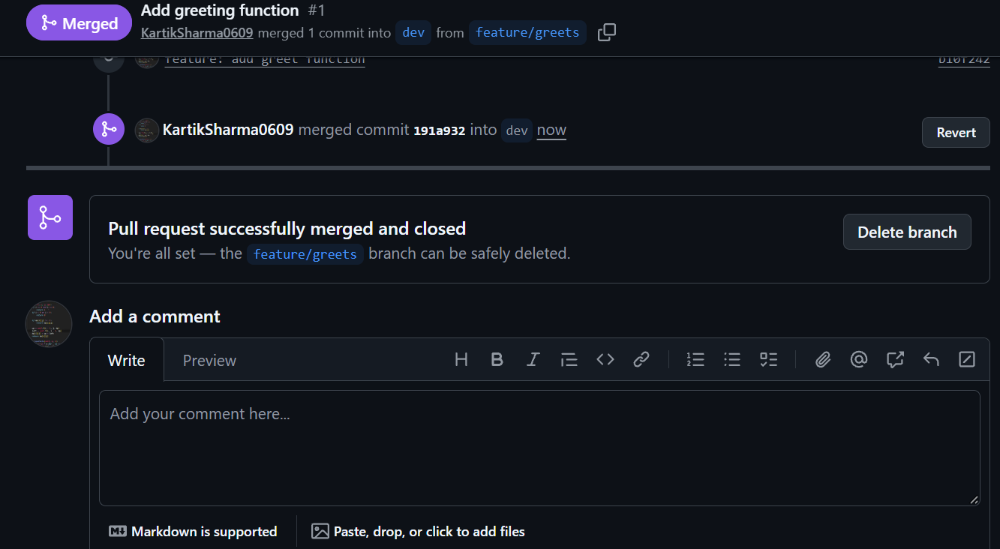
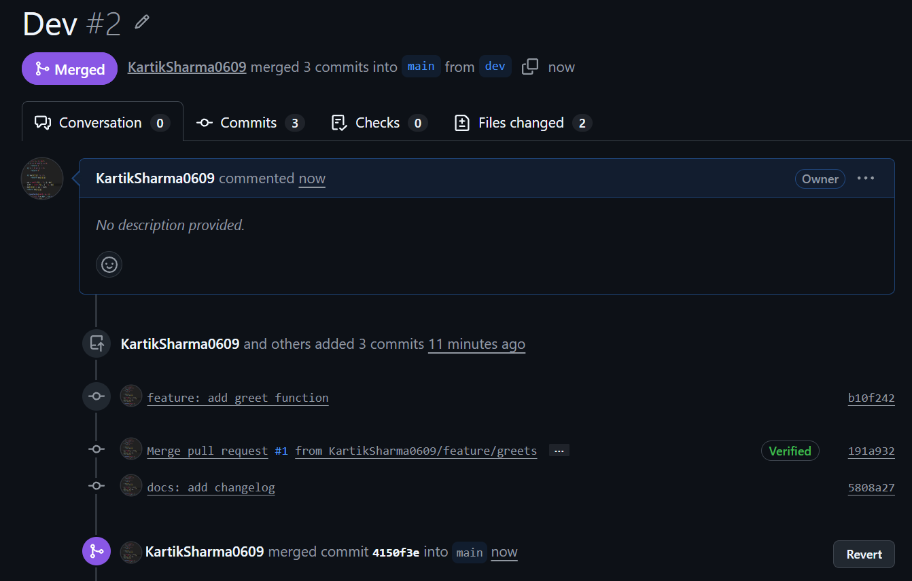
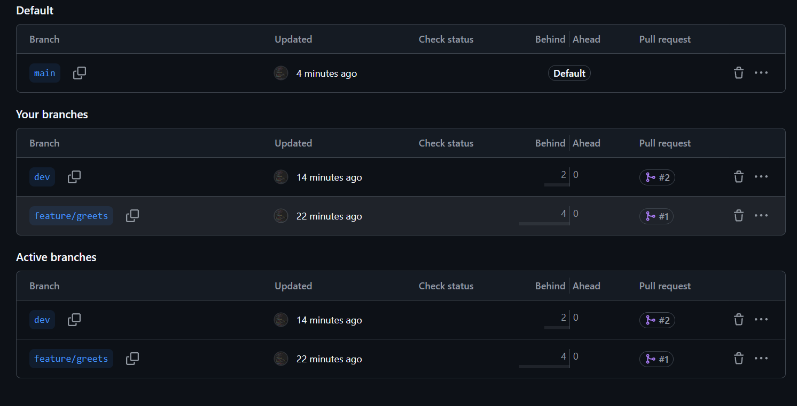
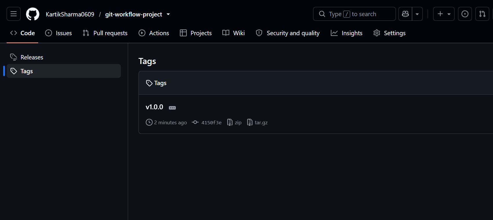
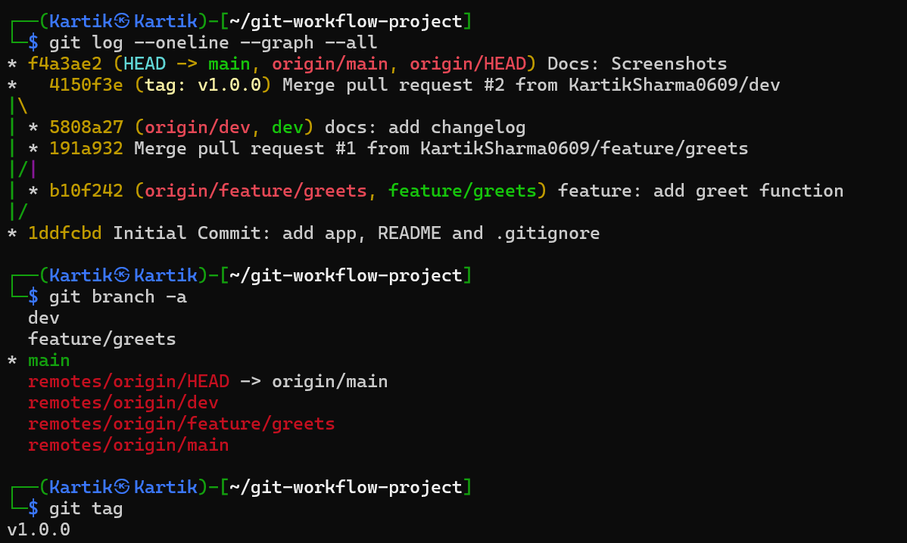

# Task 4: Version-Controlled DevOps Project with Git

## Overview
A small Python project used to practice Git best practices: branching, pull requests, tags and `.gitignore`.

## Branching strategy
- `main`: stable, release-ready code
- `dev`: integration branch for features
- `feature/*`: one branch per feature, branched from `dev`

Flow: `feature/greeting` -> PR -> `dev` -> PR -> `main` -> tag `v1.0.0`

## Project structure
```
.
├── app.py
├── .gitignore
├── README.md
└── docs/
    ├── git-notes.md
    └── screenshots/
```

## How to run
```bash
python3 app.py
```

## Tags
- `v1.0.0`: first stable release

## Screenshots
Merges



Branches


Tags


Graph

